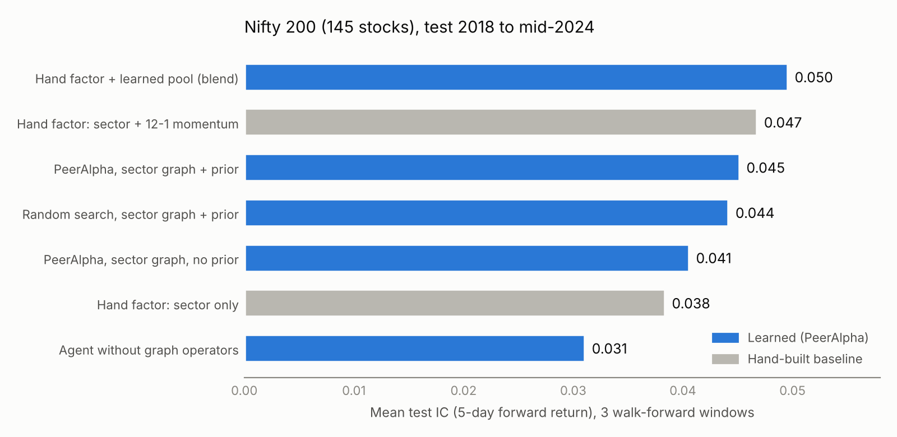
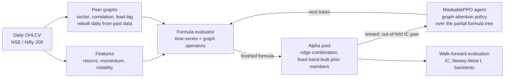

# PeerAlpha

[](https://github.com/SreenityaThatikunta/peeralpha/actions/workflows/tests.yml)

[](LICENSE)

**Reinforcement learning that writes stock-selection formulas and can look at a stock's peers.**

PeerAlpha trains a MaskablePPO agent to write interpretable alpha formulas one token at a time,
such as `Sub(NbrMean($ret20, G_sector), NbrRel($ret5, G_sector))`. Methods in the AlphaGen line only
see each stock's own price history. PeerAlpha's formula language adds **graph operators** that read
a stock's neighbours on a day-varying relationship graph (sector peers, return-correlation peers,
lead-lag leaders). The agent is rewarded for how much each new formula improves a combined pool of
alphas, scored out of fold to limit overfitting.



## Highlights

- **Graph operators help.** On real Indian equities, the agent with graph operators beats the same
  agent without them in every seed and walk-forward window (9 of 9 pairs, paired t 3.9 to 5.6).
- **Close to a strong hand-built baseline, with honest caveats.** On Nifty 200 (145 stocks,
  2018-2024 test period), blending the learned pool with a hand-built sector + 12-1 momentum factor
  gives a mean test IC of **0.050**. The hand factor alone gives 0.047. The gap is within noise, and
  on a 100-stock universe the blend only ties the baseline.
- **Better long-short portfolios.** Learned pools reach a long-short Sharpe of about 1.5 on
  Nifty 200, against 1.2 for the hand factor.
- **Rigorous evaluation.** Expanding-window walk-forward (3 test periods), 3 seeds per method,
  paired tests against controls (no-graph agent, random search, hand-built factors), Newey-West
  t-stats, and every comparison weight picked on validation, never on test.
- **Reproducible.** Seeds fixed everywhere, saved configs, pools reloaded from saved token
  sequences, full reports per experiment in `reports/`. Training runs on Kaggle CPU kernels.

## How it works



| | |
|---|---|
| **State** | The partial formula (token ids plus operator-to-operand edges of its tree), the open subtrees on the stack, and pool context (budget left, pool fill, pool IC). |
| **Action** | The next token: a feature, constant, window, graph, time-series operator, graph operator or end-of-formula. A postfix grammar builds an **action mask** so every action keeps the formula valid and type-correct. |
| **Reward** | Zero until the formula ends. Then: the gain in the pool's out-of-fold IC when the formula joins the ridge-combined pool, plus a small diversity bonus. Formulas that are invalid, duplicates, or flip sign across train folds are penalised. |
| **Policy** | A graph-attention encoder over the formula tree (an LSTM baseline is included), trained with MaskablePPO from `sb3-contrib`. |
| **Graph operators** | `NbrMean`, `NbrRel` (own value minus peer mean), `NbrRank`, `NbrStd`, `NbrMax`, `Diffuse`. All are causal: the graph for day *t* uses data up to *t-1*. |

## Results

Test IC is the mean daily cross-sectional correlation between the signal and the 5-day forward
return, averaged over 3 walk-forward test periods (2018-19, 2020-21, 2022 to mid-2024). Learned
methods average 3 seeds. Long-short Sharpe is a top-minus-bottom 20% backtest (not computed for
the blend).

**Nifty 200 (145 stocks)**

| Method | Test IC | Long-short Sharpe |
|---|---|---|
| Hand factor + learned pool, blend weight picked on validation | **0.050** | n/a |
| Hand factor: sector momentum, sector reversal, 12-1 momentum | 0.047 | 1.19 |
| PeerAlpha, sector graph, hand-factor prior | 0.045 | **1.50** |
| PeerAlpha, random search instead of PPO | 0.044 | 1.40 |
| PeerAlpha agent without graph operators | 0.031 | 0.55 |

**What the numbers say**

- Peer information carries real signal. Graph operators add about 0.014 IC over the no-graph agent.
- The hand-built factor is very hard to beat. Learned pools reach similar IC and add a small,
  not yet significant gain on top of it.
- PPO and random search over the same vocabulary score similarly, so the formula language and the
  pool design matter more than the search method.

The full history (v2 to v5, both universes, with paired tests) is in
[`docs/RESULTS.md`](docs/RESULTS.md). The design decisions and fixes along the way are in
[`docs/IMPROVEMENTS.md`](docs/IMPROVEMENTS.md).

## Quick start

```bash
git clone https://github.com/SreenityaThatikunta/peeralpha.git && cd peeralpha
python -m venv .venv && source .venv/bin/activate
pip install -r requirements.txt
pytest -q                                           # offline, synthetic data

python scripts/fetch_data.py --synthetic --out data/synthetic.npz
python train.py --config configs/smoke.yaml         # about 2 minutes
```

Real data (needs internet; see [`data/README.md`](data/README.md)):

```bash
python scripts/fetch_nse.py --out data/nse100.npz
python scripts/fetch_nse.py --universe_csv ind_nifty200list.csv --out data/nifty200.npz
```

Walk-forward experiment (3 windows x 3 seeds, then one evaluated report):

```bash
python scripts/walk_forward.py --data data/nifty200.npz --tag v5n200 --seeds 0 1 2 --valid_years 2 \
  --methods v5_sector_prior v4_sector v4_nograph v5_random_prior --steps 300000 \
  --baseline v4_nograph --hand --jobs 4 --threads 1
```

On Kaggle, `scripts/kaggle_walk_forward.py` runs one window per CPU kernel and
`scripts/kaggle_fetch_nifty200.py` builds the Nifty 200 dataset. Then score all windows together:

```bash
python evaluate.py runs/v5n200_w*_s? --group method --baseline v4_nograph --hand --out reports/v5n200_wf
```

Any config value can be overridden: `python train.py --config configs/v5_sector_prior.yaml --set total_timesteps=100000`.

## Repository layout

```
peeralpha/
  config.py     experiment config (dataclass <-> YAML, CLI overrides)
  market.py     tensors, derived features, forward-return target, purged date splits
  graphs.py     sector / rolling-correlation / lead-lag neighbour graphs (causal)
  ops.py        operator library incl. graph operators (all causal)
  expr.py       formula tree + evaluator
  vocab.py      token vocabulary (= action space), filtered by config
  grammar.py    postfix stack grammar + action masking
  pool.py       alpha pool, ridge combiner, out-of-fold reward, fixed priors
  env.py        Gymnasium environment
  policy.py     graph-attention and LSTM feature extractors
  runner.py     training loops (PPO and random search), logging
  backtest.py   long-only top-K and long-short backtests
  metrics.py    z-score, daily IC / RankIC, Newey-West t
  data.py, universe.py, synthetic.py, plotting.py
configs/        one YAML per experiment; v2_* to v5_* are the current NSE setups
scripts/        data fetchers, walk_forward.py, Kaggle kernel scripts, sanity_check.py
tests/          grammar completeness, operator causality, graph no-lookahead, pool and env tests
reports/        evaluated results per experiment (tables, formulas, figures); early pilots in reports/archive/
docs/           RESULTS.md (results history), IMPROVEMENTS.md (design log), figures/
.github/        CI: pytest on every push and pull request
train.py  evaluate.py  run_suite.py
```

## Data and evaluation protocol

- **Universes.** About 100 NSE large caps (`nse100`, hand-written sector map) and Nifty 200
  constituents with NSE industry labels (`nifty200`, 145 stocks with full history). Daily prices
  from Yahoo Finance, split and dividend adjusted, 2011-2024.
- **Features.** Prices and volume, plus scale-free features: 1, 5, 20, 60 and 120-day returns,
  12-1 month momentum, 20-day volatility, close/VWAP and high/low range.
- **No lookahead.** All operators are causal, graphs use only past returns, and the last horizon
  days of each train and validation split are purged.
- **Walk-forward.** Expanding train windows from 2012, two validation years, test periods
  2018-19, 2020-21 and 2022 to mid-2024.
- **Known limits.** The universe is today's constituents with long histories (survivorship bias),
  and VWAP is approximated by the typical price.

## Tech stack

Python, PyTorch, Gymnasium, Stable-Baselines3 / sb3-contrib (MaskablePPO), NumPy, pandas,
Matplotlib, yfinance, pytest, GitHub Actions. Experiments run on Kaggle CPU kernels.

## License

MIT, see [`LICENSE`](LICENSE).

## Acknowledgements

The token-by-token formula MDP and the synergistic alpha pool come from *Generating Synergistic
Formulaic Alpha Collections via Reinforcement Learning* (Yu et al., KDD 2023, AlphaGen). PeerAlpha
is an independent implementation. The graph operators, dynamic peer graphs, out-of-fold reward,
fixed priors and the formula-tree graph-attention policy are new here.
